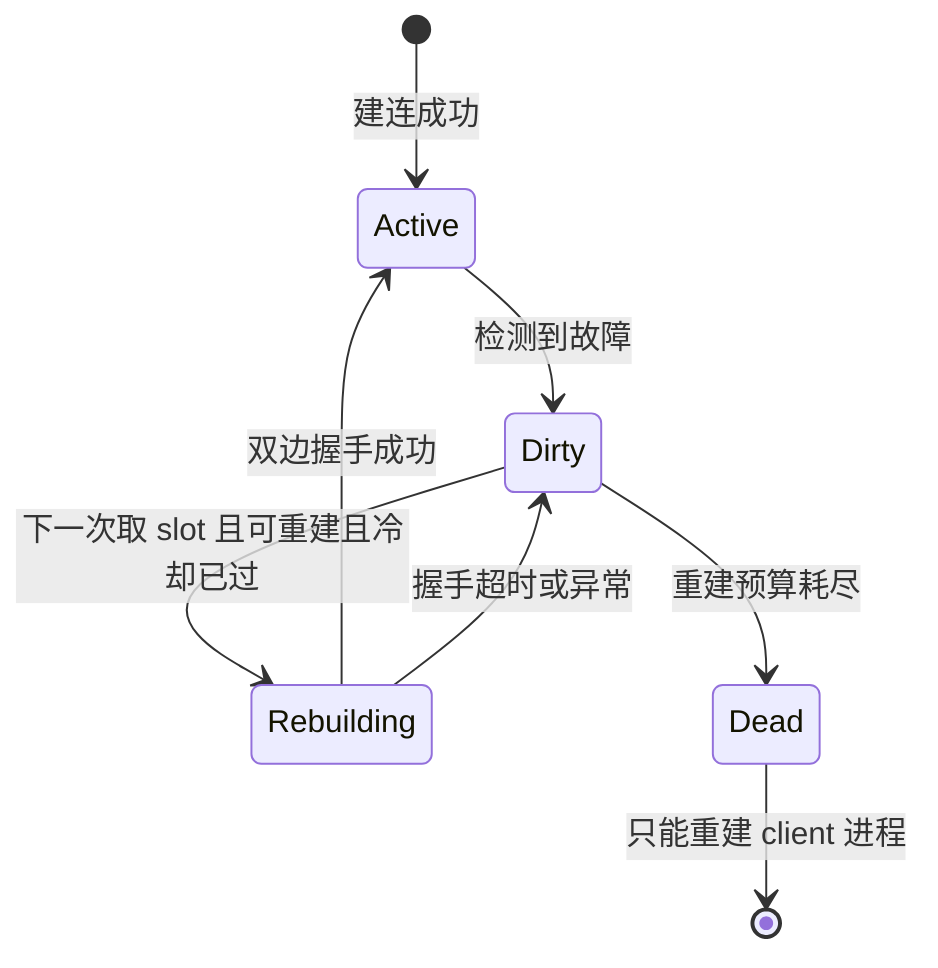

# RDMA 模块说明

本文档说明 RecStore Parameter Server 的 RDMA 主路径、入口边界和运行时约束。
可执行的构建、正确性测试、benchmark 命令、默认值和报告规则统一维护在
`rs-benchmark-ps` skill；不要在本页复制测试命令或临时性能数字。
面向真实跨机部署的配置、IB/RoCE v1/RoCE v2 选择和改造边界，以代码中的
`ResolvedRdmaDeployment` 配置契约和本页的稳定架构说明为准。

默认工作目录为仓库根目录：

```bash
cd /app/RecStore
```

## 1. 适用范围

当前文档只覆盖 Parameter Server 的 RDMA 主路径，不讨论 gRPC / bRPC 的通用网络栈。

当前实现的两个重要边界：

- RDMA 数据面使用仓内 verbs RC-write slot transport，不再依赖 Mayfly `RawMessage`。
- RDMA 控制面由 shard 0 的 `petps_server` 内置 gRPC 控制面承担，不再依赖 memcached。

RecStore 有两条 RDMA 入口：

| 入口 | 主要组件 | 用途 |
| --- | --- | --- |
| PetPS RDMA | `petps_server` + `PetPSClient` | RDMA 数据面、协议验证和专项 transport benchmark |
| Op-layer RDMA | `RDMAPSClientAdapter` + `KVClientOp` | 通过统一 op 接口接入 RDMA 后端 |

两条入口复用 RDMA transport，但初始化和参数来源不同：

- PetPS integration / benchmark 主要使用 C++ gflags 和对应 runner。
- Op-layer / Python client 使用环境变量和测试配置。
- 不要将某个 runner 的参数复制到另一条入口。

Op-layer RDMA 目前不是 gRPC/bRPC 的完整替代：`AsyncGetParameter` 已复用统一的
`RdmaDistributedExecutor`，`Command` 当前只通过首个 shard 的 `Barrier` 提供同步语义；
它主要用于 correctness / integration，而不是完整性能替代路径。

## 2. 架构

### 2.1 RC-write slot transport

- client 先将 `RequestDescriptor` 和 payload 写入 server request slot。
- `CommitWord` 最后写入，server 通过轮询 commit word 发现请求。
- server 写入 client response payload 后，最后回写 `StatusWord`。
- client 轮询 status word 判断请求完成。

同一条 QP 可以复用多个逻辑 slot。单 client 到单 shard 的在途上限是：

```text
qps-per-client-per-shard * slots-per-qp
```

因此 `qps-per-client-per-shard` 是 QP 池规模，不是单独的吞吐结论。

### 2.2 代码分工

| 文件 | 职责 |
| --- | --- |
| `src/ps/rdma/raw_verbs_transport.*` | 设备、MR、QP、CQ、控制面 metadata 交换和 verbs completion |
| `src/ps/rdma/rc_transport.*` | slot 布局、shard/client/lane offset、请求提交和 profile |
| `src/ps/rdma/petps_client.*` | PetPS 请求映射、QP 选择和 client 在途管理 |
| `src/ps/rdma/petps_server.*` | slot 扫描、协议处理和 response 完成 |

`raw_verbs_transport` 直接走真实 verbs RC 路径，不是 `shm_open + mmap` baseline。
`GlobalAddress`、QP metadata exchange 和 ready 协调由 RecStore 自维护。

### 2.3 控制面

`global_id=0` 的 `petps_server` 在启动时监听 TCP 控制面端口。client 和其他
server 通过它交换 `RawVerbsNodeMeta` 并等待 ready。控制面额外承担 shard 存活
观测：每个 shard 周期上报心跳（记录 `last_seen`），并按 `stale`/`dead` 阈值给出
`serving`/`suspect`/`dead`；client 仅在请求等待超过阈值后（慢路径）按需查询
`GetServerHealth`。因此控制面仍不参与热路径 GET/PUT/UPDATE。

常用字段：

| 参数 | 说明 |
| --- | --- |
| `--rdma-namespace` | RDMA metadata namespace，默认由 runner 自动生成 |
| `--rdma-control-plane-host` | shard 0 控制面地址 |
| `--rdma-control-plane-port` | shard 0 控制面端口；跨主机运行时应为每次运行选择唯一端口 |

## 3. 生命周期、错误处理与重试

本节回答三个问题：一条 lane 从启动到报废经过哪些阶段；失败在什么时刻被谁发现；发现之后
会不会自动重试。

### 3.1 一条 lane 的生命周期

| 阶段 | 做什么 | 失败后果 |
| --- | --- | --- |
| 配置解析 | 解析 `ResolvedRdmaDeployment`（deployment id / epoch / digests）与本机 fabric（设备、port、GID、IB 或 RoCE v1/v2） | 进程启动失败 |
| 资源创建 | **每条 lane 独立**：设备 → PD → CQ（深度 4096）→ 注册内存（默认 128 MiB）→ RC QP（`max_send_wr=1024`） | 进程启动失败 |
| 元数据交换 | `Publish()` 发布本端每个 QP 的 QPN 与 `lane_generation`；`Connect()` 拉取对端元数据并校验 | 启动失败（默认 30 s deadline） |
| QP 建连 | `RESET → INIT → RTR → RTS`，并挂满 1024 个 receive WR | 启动失败 |
| 稳态 | slot 提交、服务端扫描、响应回写 | 见 3.2 |
| 退化与恢复 | lane 置脏 → 懒重建 → 恢复为 `Active` 或进入终态 `dead` | 见 3.3 |
| 关闭 | client 析构时 drain 未收割的 signaled WR；server `Stop()` 停 payload worker、join 全部轮询与心跳线程，**不发 draining** | — |

启动路径全部是"快速失败"：任何一步失败都直接抛异常、进程起不来。运行路径才是
"降级 + 有限自愈"。读代码时看到启动期的 `throw` 不必意外，那是设计。

单条 lane 的运行时状态只有四个：



四个标志位都在 `PetPSClient::QpContext` 上：`dirty`（当前不可用）、`rebuildable`
（这个原因能否靠重建治）、`dead`（终态）、`epoch`（每次重建 +1，让等待旧 slot 的请求立刻失败）。

### 3.2 错误分七层

| 层 | 检测点 | 信号 | lane 是否置脏 | 可恢复 |
| --- | --- | --- | --- | --- |
| 本地用法 | 参数与容量校验 | `std::runtime_error` | 否 | 改参数 |
| verbs post | `ibv_post_send` 返回值 | `std::runtime_error` | **否（已知缺口）** | 通常不能 |
| 设备层 | CQE `status != SUCCESS` | `RawVerbsCompletionException` | 是 | 仅 peer 侧可重建 |
| tracked write 超时 | 等不到 signaled WR 的 CQE | `RcTrackedCompletionTimeout` | 是 | 仅 peer 侧可重建 |
| 等待超时 | 等 status word 超过 `--rdma-wait-timeout-ms` | 普通 `runtime_error` | 是 | 可重建 |
| 节点层裁决 | 控制面 `GetServerHealth` 返回 `dead` | `ShardUnreachableError` | 是 | 可重建 |
| 服务端业务 | status word 里的 `RpcStatus` | 正常响应（0 / -1..-6） | 否 | 由调用方决定 |

三条规则把上表串起来：

1. **只有 peer 侧故障可重建。** CQE 错误按 `peer_unreachable`（retry 用尽）、`flushed`、
   `peer_rejected`、`local_error`、`other` 分类，只有前两类说明"对端不说话了"，
   重建才有意义；本地错和对端拒绝重建治不了。
2. **只要 slot 内存可能仍被对端引用，就报废整条 lane。** 等待超时、drain 超时、CQE 错误
   都属此类。代价是丢一条 lane，收益是绝不出现"两个请求的 payload 混在一起"这种静默错误。
3. **服务端业务错误不涉及 lane。** `RpcStatus` 走 status word，是正常响应；
   重试一次大概率还是同一个错误码，所以传输层不做任何重试。

#### 三种没有设备层信号的失败

RDMA RC 只在**有 WR 在飞**时才通过 ACK 超时暴露链路问题。因此：

- **对端进程被杀死、但 WRITE 已被 ACK**：这次 WRITE 的 CQE 是成功；下一次 WRITE 才会撞
  `RETRY_EXC_ERR`。杀死瞬间在飞的请求没有设备层信号。
- **对端重启但链路空闲**：QP 空闲不发包，本地看不到任何异常，旧 QPN 的 QP 看起来正常。
- **控制面本身不可达**：`GetServerHealth` 返回 `known=false`，这**不是**"不健康"，
  请求退回自己的等待预算，不会误判。

前两种只能靠节点层心跳（`dead` 阈值默认 9 s）或等待超时兜住——这是"设备层 + 节点层"
两条检测通道必须同时在的原因。

### 3.3 重试：四层，只有一层是真重试

| 层 | 机制 | 重试对象 | 应用可见 | 默认 |
| --- | --- | --- | --- | --- |
| 硬件 | verbs RC 重试（`timeout=14`、`retry_cnt=7`、`rnr_retry=7`） | 单个 WQE | 不可见 | 恒开 |
| 传输 | tracked-write 重等：复用 slot 前先等上一个 CQE | 完成事件（不是请求） | 不可见 | 恒开 |
| lane | QP 重建（reset → drain → 重配 → 双边 generation 握手） | 整条 lane | 可见 | `--rdma-lane-rebuild-enabled`，默认关 |
| 请求 | **不存在** | — | 可见（异常） | — |

lane 重建的几个稳定语义：

- **触发点是取 slot，不是后台线程。** 没有流量就不会重建；一条 lane 能服务时，其余降级
  lane 不会被主动修（无 sweep），容量会持续偏低直到流量落到那条 lane。
- **预算是进程生命周期累计。** `rebuild_attempts` 只增不减，成功恢复也不清零：默认 3 次是
  "这条 lane 一生能救几次"，不是"每次中断的配额"。
- **握手成功的判据是对端 generation 变大**，不是"我 reset 完就算成功"。两侧独立计数，
  所以一次失败的握手把 generation 推高，也不会让下一次误判成功。
- **重建成功后，被打断的请求是失败，不是重放。** 重建时无法判断该请求是否已被服务端执行
  （`UPDATE` 走 optimizer 应用梯度，重复执行会改变结果），所以在"可能重复执行"和"一定失败"
  之间选择后者，由上层决定是否整批重来。
- **`num_os_clients > 1` 拒绝重建。** 服务端一条 lane 的 CQ 上挂着多个 client 进程的 QP，
  reset 后无法安全 drain，两端都保持终态置脏并记一次 warning。

请求级重试当前不存在：`ShardUnreachableError` 会一路冒到调用方，多 shard batch 里任一 shard
失败即整批失败，由上层整批重试。异常里只有拼好的文本，没有结构化的 shard / lane 字段，
因此上层还不能只重试失败的那个 shard。

### 3.4 故障时延与恢复包线

| 量 | 值 | 说明 |
| --- | --- | --- |
| 硬件 ACK 超时 | ≈67 ms / 次，7 次重试 | `timeout=14`、`retry_cnt=7` |
| 设备层发现"对端不回 ACK" | 实测 4.2–4.4 s | 理论 ≈0.5 s，差距原因未定位 |
| 慢路径健康查询起始 | 1 s | `--rdma-health-probe-after-ms` |
| 等待期 CQ 收割间隔 | 50 ms | `--rdma-cq-harvest-interval-ms` |
| 心跳 / `suspect` / `dead` | 1 s / 3 s / 9 s | `--rdma-heartbeat-interval-ms` 等 |
| 单次重建尝试最坏 | ≈4 s | `--rdma-lane-rebuild-wait-ms` × 2（取 meta + 等 ack） |
| 默认恢复包线 | ≈13.3 s，之后终态 `dead` | 实测"首个 `lane_dirty` → 最后一个 `lane_rebuild_exhausted`" |
| 重建预算 | 3 次，进程生命周期累计 | `--rdma-lane-rebuild-max-attempts` |

排障时按报错时延就能大致定位通道：**1 s 内**报错通常是慢路径健康裁决；**4 s 左右**是设备层
CQE；**等到接近等待超时**说明收割与慢路径都被关了（对应 flag 设 0），或控制面不可达。

### 3.5 运行时约束

- `async_stream` 要求 `qps-per-client-per-shard * slots-per-qp >= async-depth`。
- QP 资源不足时，`RawVerbsTransport` 会在初始化阶段失败；常见错误是
  `ibv_create_qp failed` 或 `no idle RC write slot available`。
- `slots-per-qp` 默认是 `1`，增加它主要提高在途深度，不增加 QP 数。
- `read` 和 `push` 是不同的 PUT-v2 payload 路径，结果不能直接混合比较。
- `rdma-get-response-mode=auto` 会按 index/value layout 选择 GET response path；
  当前 `DRAM_PET_HASH` 使用 `staging_copy`，其他 index 默认使用 `direct_sg`。
- Debug/O0 适合调试，不应作为吞吐结果；benchmark 报告使用 Release 构建。
- 源码修改后必须重编对应的 `petps_server`、benchmark、integration 或 op-layer target，
  否则旧 binary 可能掩盖修改结果。
- 热点路径零开销：正常请求（µs 级完成）既不查控制面（1 s 后才查）也不收割 CQ
  （50 ms 后才收割）；lane 重建检查在开关关闭时直接返回。

## 4. 关键参数

以下只保留容易影响语义或排障的参数；当前 benchmark 默认值和完整参数组合见
`rs-benchmark-ps` skill。

| 参数 | 含义 |
| --- | --- |
| `--qps-per-client-per-shard` | 每个 client 到每个 shard 的 QP 数 |
| `--slots-per-qp` | 每条 QP 的逻辑 slot 数 |
| `--async-depth` | `async_stream` 单 client 的在途请求深度 |
| `--rdma-put-protocol-version` | PUT 协议版本；`2` 是当前主路径 |
| `--rdma-put-v2-transfer-mode` | PUT-v2 payload 方式：`read` 或 `push` |
| `--rdma-wait-timeout-ms` | RDMA 请求等待超时；默认 `60000`。实际报错通常更早，由慢路径或 CQ 收割先命中（见 3.4） |
| `--rdma-heartbeat-interval-ms` | shard 心跳上报周期；默认 `1000` |
| `--rdma-health-stale-ms` | 无心跳判 `suspect` 的空闲阈值；默认 `3000` |
| `--rdma-health-dead-ms` | 无心跳判 `dead` 的空闲阈值；默认 `9000` |
| `--rdma-health-probe-after-ms` | 慢路径健康查询起始等待；默认 `1000`，`0` 关闭慢路径 |
| `--rdma-health-probe-interval-ms` | 慢路径查询/判定间隔；默认 `1000` |
| `--rdma-health-probe-timeout-ms` | 慢路径健康查询 RPC 超时；默认 `1000` |
| `--rdma-cq-harvest-interval-ms` | 等待期 CQ 收割间隔；默认 `50`，`0` 关闭（旧行为） |
| `--rdma-lane-rebuild-enabled` | 置脏 lane 的 QP 重建自愈；默认关闭，需 server 与 client 同时开启 |
| `--rdma-lane-rebuild-max-attempts` | 每条 lane **进程生命周期内累计**的重建次数上限，超过进入终态 `dead`；成功恢复不重置计数；默认 `3` |
| `--rdma-lane-rebuild-wait-ms` | 双边重建握手等待 peer ack 的期限；默认 `2000` |
| `--rdma-lane-rebuild-poll-ms` | server 轮询 client `lane_generation` 的间隔；默认 `50` |
| `--rdma-lane-rebuild-poll-max-ms` | 空闲退避上限：每轮未重建则间隔翻倍，最高到此值；默认 `500` |
| `--rdma-lane-rebuild-poll-timeout-ms` | server 侧重建轮询里 `GetMeta` 的超时；默认 `100`，避免控制面拖住数据面线程 |
| `--rdma-lane-rebuild-cooldown-ms` | 同一 lane 两次重建尝试的最小间隔；默认 `1000` |
| `--rdma-get-response-mode` | GET response 路径：`auto`、`direct_sg` 或 `staging_copy` |
| `--server-rdma-threads` | generic PS runner 的 server polling thread 数 |
| `--rdma-rc-server-get-workers` | GET payload worker 数；`0` 表示 poller 同步处理 |
| `--rdma-rc-server-coroutines-per-thread` | 每个 polling thread 的 scanner coroutine 数 |

拓扑参数要按入口理解：generic PS runner 使用 `--server-shard-ips`、
`--client-ips` 和 `--client-processes-per-ip`；专项 RC runner 使用
`--server-count`、`--client-count` 和 `--thread-num`。不要混用两组参数。

## 5. Profile 解读

Profile 主要分为三层，先确认 benchmark 所属层级，再解释数字。

### Client：`component=rdma_rc_client_profile`

重点字段：`submit_request_ns`、`wait_status_ns`、`copy_response_ns`、
`revoke_resource_ns`、`pending_rpc_peak`、`acquire_qp_failures`。

提交、等待或 response copy 分别偏高时，对应 client 固定开销、completion/服务端处理、
或数据搬运可能是瓶颈；`acquire_qp_failures` 表示资源不足，不是性能变慢。

### Server：`component=rdma_rc_server_profile`

重点字段：`poll_loop_ns`、`scan_rounds`、`ready_slots`、`empty_scan_rounds`、
`handle_get_ns`、`get_batch_get_ns`、`get_zero_fill_ns`、`get_row_copy_ns`、
`complete_response_ns`。

`empty_scan_rounds` 高通常表示低负载空轮询过重；GET 的 batch lookup、zero-fill、
row copy 和 response completion 可分别定位查找、清零、搬运和回写成本。

### Transport：`component=rdma_rc_transport_profile`

重点字段：`submit_request_ns`、`drain_pending_submit_ns`、`complete_response_ns`、
`drain_pending_response_ns` 以及各类 write count。drain 时间高通常说明提交或 response
存在背压。

## 6. 排障入口

按以下顺序缩小范围：

1. 确认 binary 是最新构建，并且使用了正确的入口参数。
2. 检查 `/dev/infiniband`、`ibv_devices` 和 shard 0 控制面日志。
3. 若卡在 `control-plane-wait` 或 `startup-wait`，先查看 shard 0 日志和控制面端口。
4. 若出现 `librdkafka.so.1` 缺失，确认 `build/lib` 在运行时库路径中：
   `LD_LIBRARY_PATH=/app/RecStore/build/lib:${LD_LIBRARY_PATH}`。
5. 若出现 `unknown command line flag 'rdma_transport_mode'` 或旧的
   `--use-local-memcached`，优先检查是否运行了旧 binary 或旧 runner。
6. 若请求卡住，检查 MR 注册、QP metadata 的 shard/lane 匹配、CQ 消费线程以及
   client/server transport mode。
7. 若已知是故障场景，直接用日志事件定位到 3.2 的层：

| 日志事件 | 层 | 含义 |
| --- | --- | --- |
| `event=lane_dirty` | 设备层 / 等待超时 / 节点层 | 某条 lane 被判死；`reason=` 指明触发点，`verdict=` 是当时的心跳裁决 |
| `event=lane_recovered` | 恢复 | 重建成功；`attempts` 是生命周期累计值 |
| `event=lane_rebuild_timeout` | 恢复 | 握手 2 s 内未收到对端新 generation；先确认对端是否也开了重建 |
| `event=lane_rebuild_failed` | 恢复 | 握手抛异常；`error=` 区分控制面还是 verbs |
| `event=lane_rebuild_exhausted` | 恢复 | 预算耗尽，该 lane 进入终态 `dead` |
| `event=lane_rebuild_skipped` | 恢复 | `reason=shared_server_cq`，即 `num_os_clients>1`，属部署形态而非缺陷 |
| `event=handler_exception` | 服务端业务 | handler 抛异常，客户端会收到 `-6`（`kInternalError`），进程不退出 |
| `event=get_payload_dropped_stale` | 服务端 fence | payload 因重建作废、不再写 status；这是"防住了"，不是故障 |


构建、RDMA verbs 检查、PetPS integration、op-layer 测试、脚本单测和最小真实 RDMA
闭环命令见 `rs-benchmark-ps` skill。

## 7. 维护边界

- 本页维护稳定的架构事实和参数语义，不维护某次运行的吞吐数字、矩阵结果或路线图。
- benchmark 输出、日志和 `summary.md` 放在独立的 `results/` 目录。
- 性能比较必须标注 storage-only、PS/network 或 PyTorch/model 层；解释规则见
  [`docs/agent/perf.md`](../agent/perf.md)。
